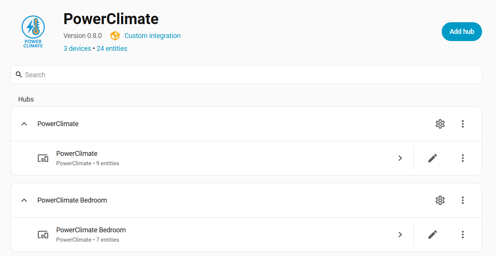
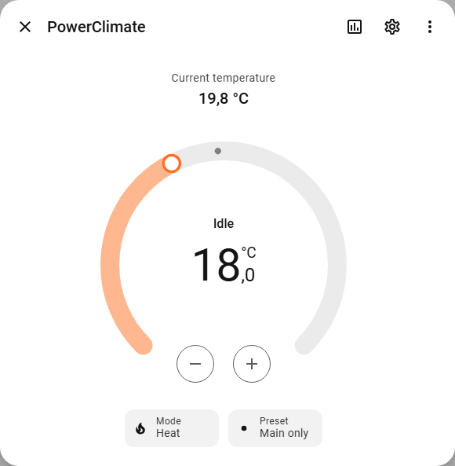
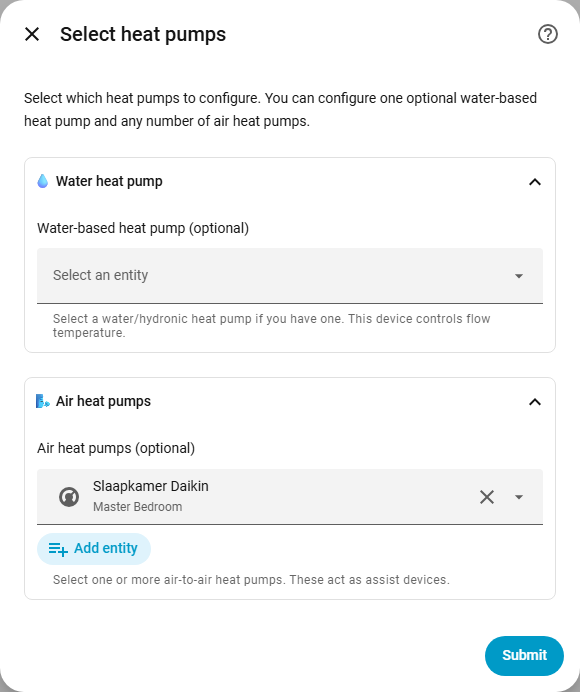
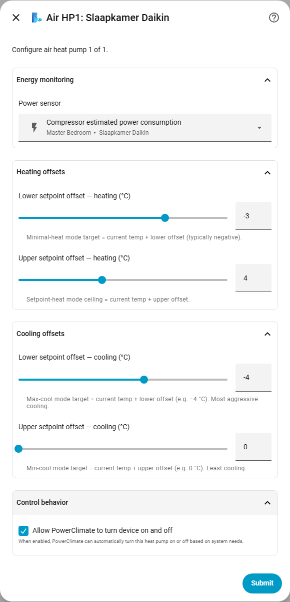
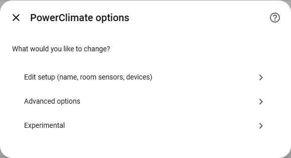
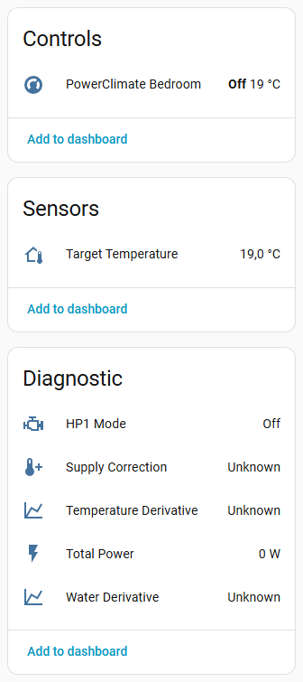

# PowerClimate

Home Assistant custom integration that lets one virtual thermostat run several
heat pumps together: an optional water-based heat pump plus any number of
air-based (assist) heat pumps. PowerClimate coordinates their setpoints with
per-device temperature offsets and can switch assists on and off by itself.

Not affiliated with Home Assistant.

## Features

- **Multi-heat-pump orchestration**: one virtual thermostat drives an optional water-based heat pump and any number of air-based assist heat pumps.
- **Per-device offsets and limits**: separate lower/upper offsets for heating and cooling per device, plus global minimum/maximum setpoints.
- **Heating and cooling**: air heat pumps that can cool are used in cool mode; the water heat pump is left out of cooling.
- **Manual or automatic assists**: you decide when assists run, or let PowerClimate switch them on and off with timers and anti-short-cycle protection.
- **Presets**: `none`, `boost`, `away`, `main only` (only the main heat pump) and `supply advice` (steer the water heat pump's supply temperature towards an advised value).
- **Thermostat mirroring**: setpoint changes on selected thermostats are copied to PowerClimate.
- **Diagnostics**: a mode sensor per heat pump, room and water derivatives, total power and a diagnostics download.
- **Standard services only**: PowerClimate controls your existing `climate.*` entities through Home Assistant.

## Installation

### HACS (recommended)

1. In Home Assistant, open **HACS → Integrations → Custom repositories**.
2. Add this repository's URL and set **Category** to **Integration**.
3. Search for **PowerClimate** and install it.
4. Restart Home Assistant.

Pre-releases (alpha and beta versions) are only offered when you enable them for PowerClimate in HACS.

### Manual

Copy `custom_components/powerclimate/` into your Home Assistant `config/custom_components/` and restart Home Assistant.

## Setup

1. Go to **Settings → Devices & Services → Add Integration → PowerClimate**.
2. Give the hub a name and select one or more room temperature sensors (PowerClimate uses the average of the available values).
3. Optionally select thermostats to mirror. Only their setpoint changes are copied to PowerClimate; turning a mirrored thermostat off does not turn PowerClimate off.
4. Select an optional water-based heat pump (0 or 1) and zero or more air-based assist heat pumps. The first mirrored thermostat is preselected as water heat pump.

   

5. Configure each heat pump on its own page: power sensor, water temperature sensor (water heat pump), heating and cooling offsets, and whether PowerClimate may turn it on and off.

   

Set the lower heating offset so that the heat pump almost, but not completely, stops: with −3 °C the setpoint is at least 17 °C while the heat pump itself measures 20 °C.

Change the setup later under the hub's **Configure** button: edit the setup and devices, tune the advanced options, or set up the experimental supply advice.

## Presets

| Preset | Water heat pump | Air heat pump(s) |
|--------|-----------------|------------------|
| **none** | Follows the room target within its offsets | Follow the room target if on; left alone if off (unless PowerClimate may switch them) |
| **boost** | Current temperature + upper offset | Turned on (if allowed) and set to current temperature + upper offset (cooling: + lower offset) |
| **away** | Minimal (current temperature + lower offset); the room target drops to the minimum setpoint | Turned off if allowed, otherwise minimal; in cool mode the room target rises to the maximum setpoint |
| **main only** | As in `none` | Only the main heat pump runs (the first air heat pump when there is no water heat pump); the others are turned off if allowed, otherwise left alone |
| **supply advice** | Its setpoint is steered so that the measured supply temperature follows an advice sensor | As in `none` |

The supply advice preset appears once a supply advice sensor is set under **Configure → Experimental**.

## Sensors

Each hub is a device with these entities:

| Entity | Description |
|--------|-------------|
| Climate | The virtual thermostat; its attributes hold the full system state (room, ETA, status per heat pump, assist timers, supply control) |
| HPx Mode | Per heat pump: the mode PowerClimate runs it in (`off`, `minimal`, `setpoint`, `boost`, `supply_advice`), with its status as attributes |
| Temperature Derivative | Room temperature change (°C/h) |
| Water Derivative | Supply water temperature change (°C/h) |
| Total Power | Sum of the configured power sensors |
| Target Temperature | PowerClimate's room target as a sensor |
| Supply Correction | Setpoint correction of the supply-temperature control |
| Room Correction | Setpoint correction of the water heat pump's room control (experimental) |

## Documentation

- Detailed documentation (EN): [docs/README.md](docs/README.md)
- Gedetailleerde documentatie (NL): [docs/README-NL.md](docs/README-NL.md)
- Release notes: [CHANGELOG.md](CHANGELOG.md)

## Support

Issues and feature requests: use the GitHub issue tracker linked in the integration manifest.
