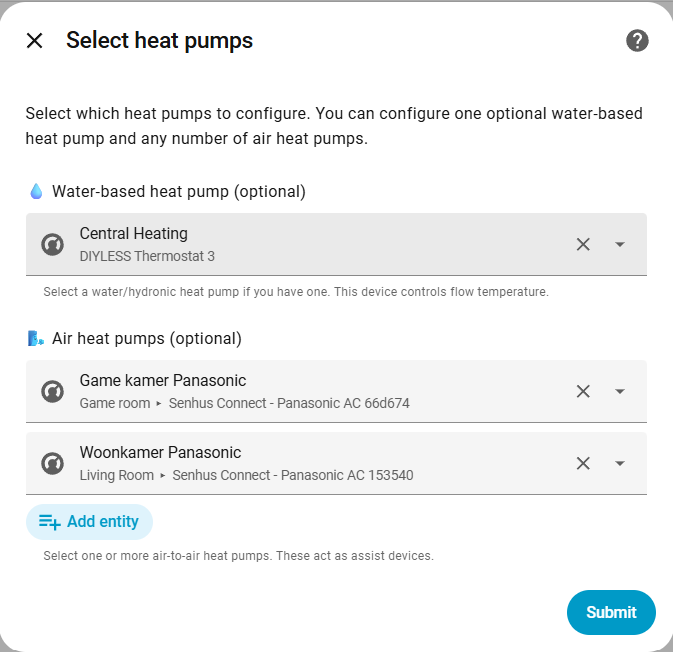

# PowerClimate (NL)

Home Assistant custom integratie om meerdere warmtepomp climate devices samen te laten werken.

## Audit-log

- 0.2 — Eerste publieke versie
- 0.3-beta — Verbeterde configuratie en water-warmtepomp nu optioneel
- 0.4.0-beta — Kernlogica opgesplitst, assist-regeling, zonne-energiebudgetten en opmaaktools
- 0.5-beta — Separated mirror thermostats

## Functies

- **Combineren meerdere warmtepompen**: een virtuele thermostaat die een water-warmtepomp en lucht warmtepompen (Airco's) bestuurt.
- **Offsets + guardrails**: lower/upper offset per apparaat en globale min/max setpoints.
- **Assists: handmatig of automatisch AAN/UIT**: optionele timers + anti-short-cycle beveiliging.
- **Diagnostiek**: thermische samenvatting, per-HP behavior, afgeleides en totaal vermogen.
- **Thermostaat-mirroring**: kopieer alleen setpoint-wijzigingen van geselecteerde thermostaten naar PowerClimate; HVAC aan/uit van die thermostaten wordt genegeerd.
- **Standaard HA services**: stuurt bestaande `climate.*` entities via Home Assistant.


## Snelstart

1. Installeer de `powerclimate` folder onder `custom_components/`.
2. In Home Assistant: **Instellingen -> Apparaten & Diensten -> Integratie toevoegen -> PowerClimate**.
3. Kies de ruimtetemperatuursensor en selecteer optioneel thermostaten om te mirroren. Alleen setpoint-wijzigingen worden overgenomen; het uitschakelen van een gemirrorde thermostaat schakelt PowerClimate niet uit.
4. Configureer je warmtepompen (de eerste gemirrorde thermostaat wordt vooraf geselecteerd voor de waterwarmtepomp):
  - **Waterwarmtepomp** (optioneel): climate entity, optionele vermogenssensor, optionele water
    temperatuursensor, en offsets
  - **Lucht- (assist) warmtepompen** (optioneel, 0..n): climate entity, optionele vermogenssensor, offsets per apparaat,
    en optioneel automatische AAN/UIT controle



## Configuratie

De configuratie is rol-gebaseerd: je kunt een optionele waterwarmtepomp
(0 of 1) configureren en nul of meer lucht- (assist) warmtepompen. Voor de
apparaatselectie kun je optioneel thermostaten kiezen waarvan setpoints worden
gemirrord naar PowerClimate. Alleen numerieke temperatuurwijzigingen worden gemirrord; HVAC-moduswijzigingen niet. De UI toont daarna aparte configuratiepagina's per
apparaat waar je de opties kiest.

## Regel-logica

### Waterwarmtepomp (optioneel)

- Indien geconfigureerd beheert PowerClimate de HVAC mode van het water-apparaat: het wordt geforceerd naar HEAT zolang de virtuele
  climate entity aan staat, en expliciet naar OFF gezet wanneer PowerClimate wordt uitgezet.
- Het PowerClimate doelsetpoint wordt begrensd tussen de lower/upper offsets (en de globale 16–30 °C limieten)
  voordat deze naar de warmtepompen gestuurd wordt.
- Watertemperatuur wordt gemeten en ter info wanneer een watersensor is geconfigureerd.

### Lucht warmtepompen (0..n)

#### Handmatige controle (default)

- Standaard beheert de gebruiker de HVAC mode van elke assist. Als een assist uit staat,
  laat PowerClimate hem ongemoeid.
- Als een assist aan staat, vergelijkt PowerClimate de ruimtetemperatuur met de gevraagde target:
  - **Minimal-modus** (kamer >= target): setpoint = huidige temp + lower offset.
  - **Setpoint-modus** (kamer < target): setpoint = gevraagde target begrensd
    tussen `current + lower offset` en `current + upper offset`.

#### Automatische AAN/UIT controle (optioneel)

- Zet **"Allow PowerClimate to turn device on and off"** aan voor een assist om
  PowerClimate automatisch de HVAC mode te laten beheren op basis van systeembehoefte.
- PowerClimate monitort condities en gebruikt **5-minuten timers** om snel pendelen te voorkomen:
  - **AAN-condities** (onderling exclusief met UIT-condities):
    1. **ETA > 60 minuten (default)**: ruimte doet er langer over dan de ingestelde drempel om target te bereiken
    2. **Water ≥ 40 °C**: watertemperatuur van de primaire pomp is 40 °C of hoger
    3. **Stalled onder target**: room derivative ≤ 0 EN ruimte is > 0.5 °C onder target
  - **UIT-condities** (onderling exclusief met AAN-condities):
    1. **ETA < 15 minuten (default)**: ruimte bereikt target binnen de ingestelde drempel
    2. **Stalled op target**: room derivative ≤ 0 EN ruimte zit binnen 0.5 °C van target
  - Als een conditie waar is, loopt diens timer op; de tegenovergestelde timer wordt gereset
  - Als geen AAN of UIT conditie waar is, resetten beide timers naar nul
  - Er wordt pas geschakeld als een conditie 5 minuten waar blijft (300 seconden, configureerbaar)
- **Anti-short-cycle (alleen bij assist AAN/UIT controle)**
  - Indien ingeschakeld blokkeert PowerClimate het schakelen van een assist:
    - **UIT** totdat hij minimaal *Min ON time* aan stond (default 20 minuten)
    - **AAN** totdat hij minimaal *Min OFF time* uit stond (default 10 minuten)
  - Dit geldt ook als je handmatig togglet (de integratie respecteert het protectievenster)
- Timerstatus is **persistent** en overleeft Home Assistant restarts (opgeslagen in `.storage/powerclimate_timers_*.json`)
- Alle temperaturen worden begrensd tussen globale min/max voordat er commando's worden gestuurd.

## Preset Gedrag

PowerClimate presets sturen het gedrag van warmtepompen in verschillende scenario's:

| Preset | Water warmtepomp | Lucht warmtepomp(en) |
|--------|------------------|----------------------|
| **none** | Normale werking (HEAT mode, volgt setpoint). Als `Allow PowerClimate to turn device on and off` voor het water-apparaat aan staat, kan aanhoudende overshoot boven `Maximum overshoot` het apparaat na de ingestelde timerduur UIT zetten; het gaat meteen weer AAN zodra er enige warmtevraag is (kamer onder setpoint) | Volgt setpoint als AAN, niet aanpassen als UIT |
| **boost** | Boost mode (huidig + upper offset) | Boost mode (huidig + upper offset) |
| **Away** | Minimal-modus (laat temp zakken naar 16 °C) | UIT (als allow_on_off aan staat), anders minimal |
| **MPC** | Stuurt de aanvoertemperatuur naar het advies van de geconfigureerde MPC-sensor door het kamersetpoint binnen de heating-offsets van het apparaat te verschuiven (zie hieronder); valt zonder advies terug op normale setpoint-logica | Normale assist-logica op basis van warmtevraag in de ruimte |
| **Thermal** | Verwarmen: dezelfde aanvoertemperatuurregeling, met het interne thermische model als advies | Verwarmen: normale assist-logica. Koelen: setpoint uit het thermische model |

MPC preset vereist een geconfigureerde experimentele sensor met een geadviseerde aanvoertemperatuur, bijvoorbeeld de MPC aanbevolen aanvoertemperatuur van de integratie Quatt Warmteanalyse (stooklijn).
Away preset schakelt luchtpompen alleen uit wanneer `allow_on_off_control` voor dat apparaat is ingeschakeld.
HVAC aan/uit van gemirrorde thermostaten wordt niet doorgegeven; alleen temperatuur-setpoints worden gemirrord.
Wanneer `Allow PowerClimate to turn device on and off` op het water-apparaat is ingeschakeld, mag PowerClimate deze bij aanhoudende overshoot boven `Maximum overshoot` ook UIT schakelen. Terug inschakelen gebeurt zodra de ruimtetemperatuur weer onder het setpoint zakt (elk beetje vraag), ruim vóór de assistpompen zouden starten.

### MPC-regellogica

Veel waterwarmtepompen worden via een kamerthermostaat aangestuurd: het setpoint
van hun climate-entity is een **kamer**setpoint en de warmtepomp kiest de
aanvoertemperatuur zelf. Een geadviseerde aanvoertemperatuur (bijvoorbeeld
35 °C) kan dus niet als setpoint worden gestuurd. PowerClimate verschuift daarom
het kamersetpoint zo dat de **gemeten** aanvoertemperatuur het advies volgt.

- **Fout**: geadviseerde aanvoertemperatuur − gemeten aanvoertemperatuur (de
  watertemperatuursensor van het water-apparaat).
- **PI-regelaar**: correctie = Kp · fout + integraal. Het setpoint van het
  water-apparaat wordt *apparaattemperatuur + correctie*.
- **Grenzen**: de correctie blijft binnen de lower/upper heating-offsets van het
  water-apparaat (standaard −0,3 / +1,5 °C) en de globale min/max.
- **Zonder sprong starten**: bij het kiezen van de preset (of na een herstart)
  begint de regeling bij het huidige setpoint van het apparaat.
- **Anti-windup**: de integraal groeit niet zolang de correctie in de richting
  van de fout tegen een grens staat.
- **Compressor stil**: onder het minimale compressorvermogen staat de integraal
  stil (de aanvoertemperatuur zegt dan niets over de geleverde warmte); het
  proportionele deel blijft reageren.
- **Overshoot**: staat de kamer boven doel + `Maximum overshoot`, dan gaat de
  correctie naar de onderste offset. De water-overshoot-afschakeling blijft los
  daarvan werken.
- **Geen advies**: is de adviessensor `unknown`/`unavailable` (sommige
  MPC-bronnen melden dat als er geen warmte nodig is) of ontbreekt de
  aanvoermeting, dan geldt de normale setpoint-logica en houdt de regelaar zijn
  toestand vast.
- **Gemiddelde aanvoer**: de regelaar gebruikt een voortschrijdend gemiddelde
  van de aanvoertemperatuur (ongeveer twee minuten), zodat meetruis het
  setpoint niet bereikt.
- **Pieken**: een meting meer dan 5 K boven dat gemiddelde (bijvoorbeeld een
  ketel die via dezelfde leiding warm water maakt) houdt de laatste correctie
  vast tot de piek voorbij is; een sprong die langer dan 10 minuten duurt telt
  als echt.
- **Dode zone**: het setpoint verandert pas bij een verschil van minstens 0,2 °C.
- **Assistpompen** blijven de warmtevraag van de ruimte volgen; zij krijgen het
  advies nooit.
- De regelaar begint opnieuw bij elke wissel van preset of HVAC-modus.

De afstelling staat onder **Opties → Experimental → Aanvoertemperatuurregeling**.
De sensor **Aanvoercorrectie** toont de correctie, met het advies, de gemeten
aanvoertemperatuur, de fout en het P- en I-deel als attributen, zodat je de
regelaar tijdens het afstellen in een grafiek kunt volgen.

**Voorkom een terugkoppellus.** Rekent de MPC-bron zijn advies uit met het
kamersetpoint van de thermostaat, dan ziet hij het setpoint dat PowerClimate
zelf verschuift: een hoger setpoint verhoogt het advies, en dat verhoogt het
setpoint weer. Laat de MPC-bron in dat geval de sensor **Doeltemperatuur** van
PowerClimate als kamersetpoint gebruiken; die bevat altijd het kamerdoel dat jij
instelt.

**Andere regelaars.** Werkt er nog iets op hetzelfde advies (bijvoorbeeld een
begrenzing van geluidsniveau of vermogen van de compressor op dezelfde
aanvoerfout), dan tellen de correcties op. Houd PowerClimate de tragere van de
twee (een langere integratietijd) en let op het aantal compressorstarts.

**Configuratie-ranges:**
- Lower setpoint offset: -5.0–0.0 °C
- Upper setpoint offset: 0.0–5.0 °C

## Geavanceerde configuratie-opties

Expert users kunnen PowerClimate tunen via **Opties -> Advanced options** in de Home Assistant UI. Deze instellingen zijn optioneel; als je ze niet invult, worden defaults gebruikt.

Te vinden via: **Instellingen -> Apparaten & Diensten -> Integraties -> PowerClimate -> Opties -> Advanced options**

| Optie | Default | Range | Beschrijving |
|--------|---------|-------|-------------|
| Min Setpoint Override | 16.0 °C | 10–25 °C | Absoluut minimum dat naar een pomp wordt gestuurd |
| Max Setpoint Override | 30.0 °C | 20–35 °C | Absoluut maximum dat naar een pomp wordt gestuurd |
| Assist Timer Duration | 300 s | 60–900 s | Seconden dat een conditie waar moet blijven voor actie |
| ON: ETA Threshold | 60 min | 5–600 min | Zet assist AAN als ETA deze duur overschrijdt |
| OFF: ETA Threshold | 15 min | 1–120 min | Zet assist UIT als ETA onder deze duur komt |
| Anti-short-cycle: Min ON time | 20 min | 0–180 min | Blokkeert UIT totdat assist minimaal zo lang AAN was |
| Anti-short-cycle: Min OFF time | 10 min | 0–180 min | Blokkeert AAN totdat assist minimaal zo lang UIT was |
| Water Temperature Threshold | 40.0 °C | 30–55 °C | Zet assist AAN wanneer water deze temperatuur bereikt |
| Stall Temperature Delta | 0.5 °C | 0.1–2 °C | Temperatuurdelta voor stall-detectie |
| Maximum Overshoot | 0.5 °C | 0–5 °C | Als de ruimtetemperatuur meer dan dit boven target komt, mag een automatisch schakelbaar water-apparaat na de timerduur UIT gaan |

## Experimentele opties

Sommige features zijn bewust experimenteel en staan onder **Opties -> Experimental**.

Te vinden via: **Instellingen -> Apparaten & Diensten -> Integraties -> PowerClimate -> Opties -> Experimental**

- **MPC geadviseerde aanvoertemperatuur sensor**: kies een sensor met een geadviseerde aanvoertemperatuur. Als deze is ingesteld, wordt de preset `MPC` beschikbaar.
- **Buitentemperatuursensor**: gebruikt door het interne thermische model (preset `Thermal`).
- **Aanvoertemperatuurregeling** (presets MPC en Thermal, verwarmen):

| Optie | Default | Range | Beschrijving |
|--------|---------|-------|-------------|
| Proportionele versterking | 0,15 | 0,01–1,0 | Setpointwijziging in °C per °C aanvoerfout |
| Integratietijd | 45 min | 5–240 min | Tijd waarin de integraal één proportionele stap toevoegt; langer is rustiger |
| Minimaal compressorvermogen | 200 W | 0–2000 W | Onder dit vermogen van de waterwarmtepomp staat de integraal stil |

**Notes:**
- Wijzigingen werken direct (geen restart nodig)
- Bestaande entries zonder advanced options gebruiken defaults voor backwards compatibility
- Timerstatus wordt naar disk weggeschreven en overleeft Home Assistant restarts
- Advanced options worden opgeslagen in `config_entry.options` en gemerged via `merged_entry_data()`

## Configuratie-constanten

Alle controle-parameters staan in `const.py` en kunnen aangepast worden:

| Constant | Default | Beschrijving |
|----------|---------|-------------|
| `DEFAULT_MIN_SETPOINT` | 16.0 | Absoluut minimum temperatuur die ooit naar een pomp wordt gestuurd. |
| `DEFAULT_MAX_SETPOINT` | 30.0 | Absoluut maximum temperatuur die naar een pomp wordt gestuurd. |
| `DEFAULT_LOWER_SETPOINT_OFFSET_HP1` | -0.3 | HP1 minimal-modus offset t.o.v. eigen gemeten temperatuur. |
| `DEFAULT_UPPER_SETPOINT_OFFSET_HP1` | 1.5 | HP1 maximum offset t.o.v. eigen gemeten temperatuur. |
| `DEFAULT_LOWER_SETPOINT_OFFSET_ASSIST` | -4.0 | Assist minimal-modus offset (ruimte op temperatuur). |
| `DEFAULT_UPPER_SETPOINT_OFFSET_ASSIST` | 4.0 | Assist maximum offset bij het volgen van de ruimte-target. |

## Sensoren

PowerClimate levert meerdere diagnostische sensors om systeemstatus te monitoren. Text sensors
gebruiken het `powerclimate_text_*` naming pattern zodat je ze makkelijk kunt excluden uit recorder.

Sensoren worden alleen aangemaakt voor pompen met een geconfigureerde `climate_entity_id`.

| Sensor | Entity ID Pattern | Beschrijving |
|--------|-------------------|-------------|
| Temperature Derivative | `sensor.powerclimate_derivative_*` | Verandering van ruimtetemperatuur (°C/uur) |
| Water Derivative | `sensor.powerclimate_water_derivative_*` | Verandering van watertemperatuur (°C/uur) |
| **Thermal Summary** | `sensor.powerclimate_text_thermal_summary_*` | Leesbare systeemstatus met alle pomptemps en ETAs |
| **Assist Summary** | `sensor.powerclimate_text_assist_summary_*` | Room state, trend, en per-pomp timer/conditie status |
| **HP1 Behavior** | `sensor.powerclimate_text_hp1_behavior_*` | HVAC status, temps, watertemperatuur wanneer beschikbaar |
| **HP2+ Behavior** | `sensor.powerclimate_text_hp*_behavior_*` | HVAC status, temps en PowerClimate-mode voor elke geconfigureerde assistpomp |
| Total Power | `sensor.powerclimate_total_power_*` | Opgeteld vermogen van geconfigureerde pompen |
| Doeltemperatuur | `sensor.powerclimate_target_temperature_*` | Kamerdoel van PowerClimate, voor integraties die alleen een sensor accepteren (geen diagnostische entity) |
| Aanvoercorrectie | `sensor.powerclimate_supply_correction_*` | Setpointcorrectie van de aanvoertemperatuurregeling (presets MPC/Thermal), met de toestand als attributen |

**Text sensor details:**
- Alle text sensors (prefix `powerclimate_text_*`) kun je excluden uit recorder:
  ```yaml
  recorder:
    exclude:
      entity_globs:
        - sensor.powerclimate_text_*
  ```
- Behavior sensors labelen elke pomp als `<first word> (hpX)` om te matchen met de Thermal Summary
- Behavior-sensoren worden aangemaakt voor elke geconfigureerde pomp, niet alleen voor de eerste vijf
- Assist Summary toont:
  - Room state (temp, target, delta, trend, ETA)
  - Per-pomp status met timer countdown (bijv. "Water≥40 °C ON:3:45/5:00")
  - Conditie labels reflecteren je thresholds (bijv. ETA>60m / ETA<15m)
  - Anti-short-cycle blokkering indien van toepassing (bijv. "Blocked(min_off 420s)")
  - "Manual control" voor pompen zonder automatische AAN/UIT

## Warmtepomp tips

Algemene setup guidance (check altijd je handleiding):

- Assist pompen (HP2-HP5): gebruik waar mogelijk "heat shift" / °C offset om minimal-modus te stabiliseren; tune daarna `lower_setpoint_offset` zodat assists rustig kunnen "idle-en" wanneer de ruimte op temperatuur is.
- Water-/hybride pomp (HP1): als hybride, voorkom bijschakelen van gas voor ruimteverwarming en cap CH/flow temperatuur rond 45 °C initieel voor betere COP.

## Next Steps

- Min/max clamp values en assist timer/thresholds zijn nu configureerbaar via Advanced Options
- Gebruik energiesensoren of COP data voor economische keuzes
- Voeg unit tests toe voor assist logica en advanced configuration
- Persistent timer state is aanwezig; gebruik de assist- en behavior-sensoren om de herstelde timerstatus te controleren
