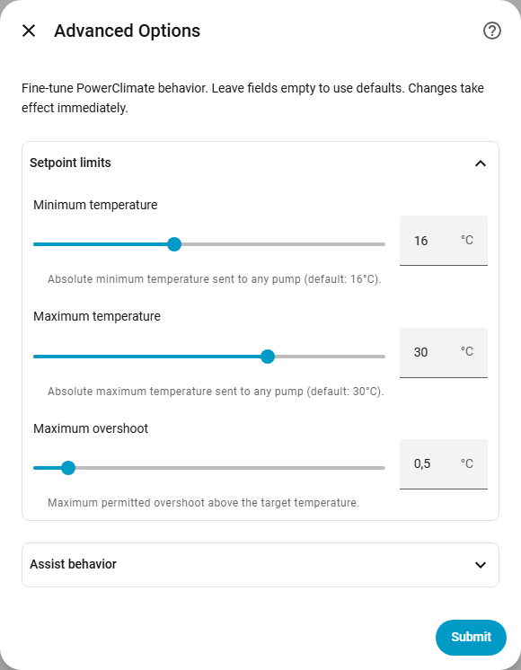

# PowerClimate (NL)

[](https://github.com/hacs/integration)

Home Assistant custom integratie waarmee één virtuele thermostaat meerdere
warmtepompen samen laat werken en hun setpoints afstemt met temperatuur-offsets
per apparaat. De release notes staan in de [CHANGELOG](../CHANGELOG.md).


## Functies

- **Meerdere warmtepompen samen**: één virtuele thermostaat stuurt een optionele waterwarmtepomp en een willekeurig aantal luchtwarmtepompen (assists).
- **Offsets en grenzen**: onder- en bovenoffsets per apparaat voor verwarmen en koelen, en een globaal minimum en maximum setpoint.
- **Assists handmatig of automatisch aan/uit**: optionele timers en bescherming tegen pendelen.
- **Presets**: `none`, `boost`, `away`, `main only` en `supply advice`.
- **Thermostaat-mirroring**: setpointwijzigingen op gekozen thermostaten worden naar PowerClimate gekopieerd; hun HVAC aan/uit wordt genegeerd.
- **Diagnostiek**: een modussensor per warmtepomp, temperatuurverloop, totaal vermogen en een diagnostiekdownload.
- **Standaard HA services**: PowerClimate stuurt bestaande `climate.*` entities via Home Assistant.


## Installatie

### HACS (aanbevolen)

1. Open in Home Assistant **HACS → Integraties → Custom repositories**.
2. Voeg de URL van de repository toe en kies **Categorie** **Integration**.
3. Zoek **PowerClimate** en installeer het.
4. Herstart Home Assistant.

Pre-releases (alfa- en bètaversies) biedt HACS alleen aan als je die voor PowerClimate inschakelt.

### Handmatig

Kopieer de map `custom_components/powerclimate/` naar `config/custom_components/` van je Home Assistant en herstart Home Assistant.

## Configuratie

1. Ga naar **Instellingen → Apparaten & diensten → Integratie toevoegen → PowerClimate**.
2. Geef de hub een naam en kies een of meer ruimtetemperatuursensoren; PowerClimate gebruikt het gemiddelde van de beschikbare waarden.
3. Kies optioneel thermostaten om te mirroren. Alleen numerieke setpointwijzigingen worden gemirrord; HVAC-moduswijzigingen van die thermostaten worden genegeerd.
4. Kies de warmtepompen: één optionele waterwarmtepomp (0 of 1) en nul of meer luchtwarmtepompen. De eerste gemirrorde thermostaat staat vooraf ingevuld als waterwarmtepomp.

   

5. Stel elke warmtepomp op een eigen pagina in:
   - **Waterwarmtepomp**: vermogenssensor, water- (aanvoer)temperatuursensor, verwarmingsoffsets, en of PowerClimate hem aan en uit mag zetten.
   - **Luchtwarmtepompen**: vermogenssensor, offsets voor verwarmen en koelen, en of PowerClimate hem aan en uit mag zetten.

   

Offsets zijn relatief ten opzichte van de temperatuur die de warmtepomp zelf
meet. De onderste verwarmingsoffset loopt van −10 tot 0 °C en de bovenste van
0 tot 10 °C (bij koelen hetzelfde). Stel de onderste verwarmingsoffset zo in
dat de warmtepomp bijna, maar niet helemaal stopt.

Later wijzigen gaat via de knop **Configureren** van de hub: **Instellingen
wijzigen** (naam, ruimtesensoren, gemirrorde thermostaten en apparaten),
**Geavanceerde opties** en **Experimenteel**.


## Regel-logica

### HVAC-modi

| Modus | Gedrag |
|-------|--------|
| **off** | PowerClimate stuurt geen setpoints. De waterwarmtepomp gaat uit als aan/uit-controle aan staat; assists blijven zoals ze zijn. |
| **heat** | De waterwarmtepomp (indien ingesteld) en de luchtassists verwarmen de ruimte naar het doel. |
| **cool** | De luchtassists koelen de ruimte naar het doel. De waterwarmtepomp gaat uit (als dat mag), want die kan niet koelen. |

### Waterwarmtepomp (optioneel)

- PowerClimate zet het setpoint van de waterwarmtepomp zolang die verwarmt: het ruimtedoel, begrensd tussen *apparaattemperatuur + onderoffset* en *apparaattemperatuur + bovenoffset* en het globale minimum en maximum.
- Met **PowerClimate mag het apparaat aan- en uitzetten** schakelt PowerClimate hem ook:
  - aan zodra er warmtevraag is (ruimte onder het doel), ruim voor de assists;
  - uit na aanhoudende doorschot: als de ruimte de duur van de assist-timer boven doel + `Maximale doorschot` blijft;
  - uit als PowerClimate uit gaat of op koelen gezet wordt.
- Zonder die optie verandert PowerClimate de HVAC-modus nooit; jij houdt de controle.
- De watertemperatuur wordt gevolgd als er een watersensor is ingesteld. PowerClimate houdt er ook een voortschrijdend gemiddelde van bij (ongeveer twee minuten) en negeert metingen die meer dan 5 K daarboven liggen tot 10 minuten lang; de assist-condities en de aanvoerregeling gebruiken die gemiddelde waarde. De climate-attributen tonen de gemeten waarde als `water_temperature` en de gemiddelde als `water_temperature_filtered`, met `water_spike` zolang een piek genegeerd wordt; beide zijn gevuld zodra de sensor een waarde heeft, ook als PowerClimate uit staat.

### Luchtwarmtepompen (assists, 0..n)

#### Handmatige controle (standaard)

- Jij bepaalt de HVAC-modus van elke assist. Staat een assist uit, dan laat PowerClimate hem met rust.
- Staat een assist aan, dan vergelijkt PowerClimate de ruimtetemperatuur met het doel:
  - **Minimaal** (ruimte op of boven het doel): setpoint = apparaattemperatuur + onderoffset.
  - **Setpoint** (ruimte onder het doel): setpoint = doel, begrensd tussen *apparaattemperatuur + onderoffset* en *apparaattemperatuur + bovenoffset*.

#### Automatische aan/uit-controle (optioneel)

- Zet **PowerClimate mag het apparaat aan- en uitzetten** aan voor een assist om PowerClimate zijn HVAC-modus te laten beheren.
- PowerClimate controleert condities en gebruikt timers (standaard 5 minuten) tegen pendelen:
  - **Aan-condities**:
    1. **ETA boven de aan-drempel** (standaard 60 minuten): de ruimte doet er langer over om het doel te halen.
    2. **Water op of boven de waterdrempel** (standaard 40 °C): de waterwarmtepomp draait warm. Dit gebruikt de gemiddelde watertemperatuur, zodat een korte piek (bijvoorbeeld een ketel die via dezelfde leiding warm water maakt) de assists niet aanzet.
    3. **Stilstand onder het doel**: temperatuurverloop ≤ 0 en de ruimte zit meer dan het stilstandverschil (0,5 °C) onder het doel. Met [kamerregeling](#kamerregeling-experimenteel) pas als de waterwarmtepomp niet harder kan.
  - **Uit-condities**:
    1. **ETA onder de uit-drempel** (standaard 15 minuten).
    2. **Stilstand op het doel**: temperatuurverloop ≤ 0 en de ruimte zit binnen het stilstandverschil van het doel.
  - Zolang een conditie geldt loopt haar timer en wordt de tegenovergestelde timer gereset; geldt geen van beide, dan resetten ze allebei.
  - PowerClimate schakelt pas als een conditie de volle timerduur heeft gegolden.
- **Bescherming tegen pendelen**: PowerClimate zet een assist niet
  - uit voordat hij de *minimale AAN-tijd* aan stond (standaard 20 minuten);
  - aan voordat hij de *minimale UIT-tijd* uit stond (standaard 10 minuten).

  Dit geldt ook nadat je een assist met de hand hebt geschakeld.
- De timerstatus wordt opgeslagen en overleeft een herstart van Home Assistant.
- Alle setpoints worden begrensd tussen het globale minimum en maximum voordat ze worden verstuurd.

## Preset-gedrag

| Preset | 💧 Waterwarmtepomp | 🌬️ Luchtwarmtepomp(en) |
|--------|-------------------|------------------------|
| **none** | Normale werking (volgt het ruimtedoel binnen zijn offsets) | Volgen het setpoint als ze aan staan; blijven ongemoeid als ze uit staan, tenzij aan/uit-controle aan staat |
| **boost** | Apparaattemperatuur + bovenoffset | Aangezet (met aan/uit-controle) en op apparaattemperatuur + bovenoffset gezet; bij koelen + onderoffset |
| **away** | Minimaal; het ruimtedoel zakt naar het minimum setpoint | Uitgezet (met aan/uit-controle), anders minimaal; bij koelen stijgt het ruimtedoel naar het maximum setpoint |
| **main only** | Zoals bij `none` | Alleen de hoofdwarmtepomp draait, zoals bij `none`; de andere worden uitgezet (met aan/uit-controle) en nooit aangezet, anders ongemoeid gelaten |
| **supply advice** | Stuurt de aanvoertemperatuur naar het advies van de aanvoeradviessensor door het kamersetpoint binnen de verwarmingsoffsets te verschuiven (zie hieronder); valt zonder advies terug op normale setpoint-logica | Normale assist-logica op basis van de warmtevraag |

- **Main only** laat PowerClimate met één warmtepomp werken: de waterwarmtepomp, of de eerste luchtwarmtepomp als er geen waterwarmtepomp is. Met een waterwarmtepomp als hoofd koelt main only niet.
- **Supply advice** verschijnt zodra er onder **Configureren → Experimenteel** een aanvoeradviessensor is ingesteld; zie [Adviesbronnen](#adviesbronnen).
- Van **away** naar `none`, `main only` of `supply advice` gaan zet het vorige doel terug.

### Regellogica aanvoeradvies

Veel waterwarmtepompen worden via een kamerthermostaat aangestuurd: het setpoint
van hun climate-entity is een **kamer**setpoint en de warmtepomp kiest de
aanvoertemperatuur zelf. Een geadviseerde aanvoertemperatuur (bijvoorbeeld
35 °C) kan dus niet als setpoint worden gestuurd. PowerClimate verschuift daarom
het kamersetpoint zo dat de **gemeten** aanvoertemperatuur het advies volgt.

- **Fout**: geadviseerde aanvoertemperatuur − gemeten aanvoertemperatuur (de
  watertemperatuursensor van het water-apparaat).
- **PI-regelaar**: correctie = Kp · fout + integraal. Het setpoint van het
  water-apparaat wordt *apparaattemperatuur + correctie*.
- **Grenzen**: de correctie blijft binnen de onder- en bovenoffset voor
  verwarmen van het water-apparaat (standaard −0,3 / +1,5 °C) en het globale
  minimum en maximum.
- **Zonder sprong starten**: bij het kiezen van de preset (of na een herstart)
  begint de regeling bij het huidige setpoint van het apparaat.
- **Anti-windup**: de integraal groeit niet zolang de correctie in de richting
  van de fout tegen een grens staat.
- **Compressor stil**: onder het minimale compressorvermogen staat de integraal
  stil (de aanvoertemperatuur zegt dan niets over de geleverde warmte); het
  proportionele deel blijft reageren.
- **Doorschot**: staat de kamer boven doel + `Maximale doorschot`, dan gaat de
  correctie naar de onderste offset. De afschakeling van de waterwarmtepomp bij
  doorschot blijft los daarvan werken.
- **Geen advies**: is de adviessensor `unknown`/`unavailable` (sommige
  adviesbronnen melden dat als er geen warmte nodig is) of ontbreekt de
  aanvoermeting, dan geldt de normale setpoint-logica en houdt de regelaar zijn
  toestand vast.
- **Gemiddelde aanvoer**: de regelaar gebruikt een voortschrijdend gemiddelde
  van de aanvoertemperatuur (ongeveer twee minuten), zodat meetruis het
  setpoint niet bereikt.
- **Pieken**: een meting meer dan 5 K boven dat gemiddelde (bijvoorbeeld een
  ketel die via dezelfde leiding warm water maakt) houdt de laatste correctie
  vast tot de piek voorbij is; een sprong die langer dan 10 minuten duurt telt
  als echt.
- **Dode zone**: het setpoint verandert pas bij een verschil van minstens 0,2 °C.
- **Assistpompen** blijven de warmtevraag van de ruimte volgen; zij krijgen het
  advies nooit.
- De regelaar begint opnieuw bij elke wissel van preset of HVAC-modus.

De afstelling staat onder **Configureren → Experimenteel →
Aanvoertemperatuurregeling**. De sensor **Aanvoercorrectie** toont de
correctie, met het advies, de gemeten aanvoertemperatuur, de fout en het P- en
I-deel als attributen, zodat je de regelaar tijdens het afstellen in een
grafiek kunt volgen.

**Voorkom een terugkoppellus.** Rekent de adviesbron zijn advies uit met het
kamersetpoint van de thermostaat, dan ziet hij het setpoint dat PowerClimate
zelf verschuift: een hoger setpoint verhoogt het advies, en dat verhoogt het
setpoint weer. Laat de adviesbron in dat geval de sensor **Doeltemperatuur** van
PowerClimate als kamersetpoint gebruiken; die bevat altijd het kamerdoel dat jij
instelt.

**Andere regelaars.** Werkt er nog iets op hetzelfde advies (bijvoorbeeld een
begrenzing van geluidsniveau of vermogen van de compressor op dezelfde
aanvoerfout), dan tellen de correcties op. Houd PowerClimate de tragere van de
twee (een langere integratietijd) en let op het aantal compressorstarts.

### Adviesbronnen

PowerClimate berekent het advies niet zelf; elke sensor met een geadviseerde
aanvoertemperatuur in °C werkt:

- een integratie die een geadviseerde aanvoertemperatuur berekent, zoals een
  MPC- of stooklijnintegratie voor je warmtepomp;
- een eenvoudige **stooklijn** als template-sensor. Maak die aan via
  **Instellingen → Apparaten & diensten → Helpers → Helper aanmaken → Template →
  Template-sensor**, met eenheid `°C` en apparaatklasse *Temperatuur*. Dit
  voorbeeld geeft 50 °C bij −10 °C buiten en 30 °C bij 15 °C buiten, lineair
  daartussen en begrensd tot dat bereik:

  ```jinja
  {{ [[50 - 0.8 * (states('sensor.outdoor_temperature') | float + 10), 50] | min, 30] | max | round(1) }}
  ```

  Zet de beschikbaarheid op `{{ has_value('sensor.outdoor_temperature') }}`,
  zodat de preset terugvalt op normale setpoint-logica als de buitensensor
  ontbreekt. Gebruik een buitensensor die niet opwarmt door een draaiende
  buitenunit.

### Kamerregeling (experimenteel)

Zonder kamerregeling krijgt de waterwarmtepomp het kamerdoel als setpoint, en
bepaalt zijn eigen thermostaat hoe hard hij werkt. Die thermostaat kan warmer
meten dan de kamersensoren van PowerClimate, en een klein maar aanhoudend
tekort geeft hem nauwelijks een afwijking om op te reageren, zodat een
assist-pomp steeds bijspringt. Kamerregeling past het setpoint van de
waterwarmtepomp aan in de presets `none` en `main only` (verwarmen):

- **Setpoint**: apparaattemperatuur + (kamerdoel − kamertemperatuur) +
  integraal. Het eerste deel geeft de kamerafwijking die PowerClimate meet één
  op één door.
- **Integraal**: groeit zolang de kamer onder het doel zit en krimpt zolang
  hij erboven zit, met de kamerafwijking per integratietijd (standaard 30
  minuten). Een tekort van 0,3 °C voegt zo'n 0,6 °C per uur toe.
- **Grenzen**: de uitkomst blijft binnen de verwarmingsoffsets van het
  waterapparaat en het globale minimum/maximum.
- **Aanvoer op de drempel**: zodra de gemiddelde aanvoertemperatuur de
  watertemperatuurdrempel haalt (Geavanceerde opties, standaard 40 °C), groeit
  de integraal niet verder.
- **Assist-pompen verwarmen**: zolang een luchtwarmtepomp verwarmt, krimpt de
  integraal niet; een kamer boven het doel komt dan door de assist. Gaat de
  assist uit, dan houdt de waterwarmtepomp zijn duw vast.
- **Doorschot**: boven doel + `Maximale doorschot` gaat het setpoint naar de
  onderste offset.
- **Stilstaande kamer**: de assist-conditie *stilstand onder het doel* wacht
  tot de waterwarmtepomp niet harder kan (setpoint op de bovenste offset, of
  aanvoer op de drempel). De ETA- en watertemperatuurcondities veranderen niet.
- **Start**: de integraal begint op nul, dus het eerste setpoint is de
  apparaattemperatuur plus de kamerafwijking; de regelaar start opnieuw bij
  elke wissel van preset of HVAC-modus en na een herstart van Home Assistant.
- **Dode zone**: het setpoint verandert pas bij een verschil van minstens
  0,2 °C.

Zet het aan onder **Configureren → Experimenteel → Kamerregeling van de
waterwarmtepomp**. De sensor **Kamercorrectie** toont de correctie (setpoint
min apparaattemperatuur), met de afwijking, het P- en I-deel en of de
waterwarmtepomp aan zijn grens zit als attributen, zodat je de regelaar in een
grafiek kunt volgen.

## Geavanceerde opties

Stem PowerClimate af via **Instellingen → Apparaten & diensten → PowerClimate → Configureren → Geavanceerde opties**. Alle velden zijn optioneel; lege velden gebruiken de standaardwaarde. Wijzigingen werken direct.



| Optie | Standaard | Bereik | Beschrijving |
|-------|-----------|--------|--------------|
| Minimumtemperatuur | 16,0 °C | 10–25 °C | Absoluut minimum setpoint dat naar een warmtepomp gaat |
| Maximumtemperatuur | 30,0 °C | 20–35 °C | Absoluut maximum setpoint dat naar een warmtepomp gaat |
| Maximale doorschot | 0,5 °C | 0–5 °C | Doorschot boven het doel waarna een waterwarmtepomp met aan/uit-controle uit mag |
| Duur assist-timer | 300 s | 60–900 s | Hoe lang een conditie moet gelden voordat PowerClimate schakelt |
| ETA-drempel inschakelen | 60 min | 5–600 min | Zet een assist aan als de ETA hierboven komt |
| ETA-drempel uitschakelen | 15 min | 1–120 min | Zet een assist uit als de ETA hieronder komt |
| Minimale AAN-tijd | 20 min | 0–180 min | Tegen pendelen: houd een assist minstens zo lang aan |
| Minimale UIT-tijd | 10 min | 0–180 min | Tegen pendelen: houd een assist minstens zo lang uit |
| Watertemperatuurdrempel | 40 °C | 30–55 °C | Zet een assist aan als het water deze temperatuur haalt |
| Temperatuurverschil voor stilstand | 0,5 °C | 0,1–2 °C | Temperatuurverschil voor stilstanddetectie |

Het minimum moet onder het maximum liggen, en de uit-drempel onder de aan-drempel.

## Experimentele opties

Onder **Configureren → Experimenteel**:

- **Aanvoeradviessensor**: een sensor met een geadviseerde aanvoertemperatuur. Als die is ingesteld, is de preset `supply advice` beschikbaar.
- **Aanvoertemperatuurregeling** (preset supply advice, verwarmen):

| Optie | Standaard | Bereik | Beschrijving |
|-------|-----------|--------|--------------|
| Proportionele versterking | 0,15 | 0,01–1,0 | Setpointwijziging in °C per °C aanvoerfout |
| Integratietijd | 45 min | 5–240 min | Tijd waarin de integraal één proportionele stap toevoegt; langer is rustiger |
| Minimaal compressorvermogen | 200 W | 0–2000 W | Onder dit vermogen van de waterwarmtepomp staat de integraal stil |

- **Kamerregeling van de waterwarmtepomp** (presets `none` en `main only`, verwarmen); zie [Kamerregeling](#kamerregeling-experimenteel):

| Optie | Standaard | Bereik | Beschrijving |
|-------|-----------|--------|--------------|
| Kamerregeling inschakelen | uit | | Geef de kamerafwijking door aan de waterwarmtepomp en verhoog zijn setpoint zolang een tekort aanhoudt |
| Integratietijd | 30 min | 5–240 min | Tijd waarin de integraal de kamerafwijking nog eens toevoegt; korter duwt harder |

## Standaard-offsets van apparaten

Nieuwe apparaten beginnen met deze offsets (gedefinieerd in `const.py`):

| Constante | Standaard | Beschrijving |
|-----------|-----------|--------------|
| `DEFAULT_LOWER_SETPOINT_OFFSET_HP1` | -0.3 | Waterwarmtepomp: offset in minimale modus. |
| `DEFAULT_UPPER_SETPOINT_OFFSET_HP1` | 1.5 | Waterwarmtepomp: bovengrens-offset. |
| `DEFAULT_LOWER_SETPOINT_OFFSET_ASSIST` | -4.0 | Luchtwarmtepomp, verwarmen: offset in minimale modus (ruimte op temperatuur). |
| `DEFAULT_UPPER_SETPOINT_OFFSET_ASSIST` | 4.0 | Luchtwarmtepomp, verwarmen: bovengrens bij het volgen van het ruimtedoel. |
| `DEFAULT_LOWER_SETPOINT_OFFSET_COOLING` | -4.0 | Luchtwarmtepomp, koelen: het sterkst koelen. |
| `DEFAULT_UPPER_SETPOINT_OFFSET_COOLING` | 0.0 | Luchtwarmtepomp, koelen: het minst koelen (minimaal). |

## Sensoren

Elke hub is een apparaat. Entity-ID's volgen de apparaatnaam, bijvoorbeeld
`sensor.powerclimate_temperatuurverloop`. De climate-entity heeft de volledige
systeemstatus (ruimte, ETA, status per warmtepomp, assist-timers,
aanvoerregeling) als attributen.

| Entity | Beschrijving |
|--------|--------------|
| **HPx modus** | Per warmtepomp: de modus waarin PowerClimate hem laat draaien (`off`, `minimal`, `setpoint`, `boost`, `supply_advice`), met zijn status als attributen: temperaturen, verloop, ETA, vermogen en, voor assists, de actieve conditie, timers en wat een schakeling blokkeert |
| Temperatuurverloop | Verandering van de ruimtetemperatuur (°C/u) |
| Waterverloop | Verandering van de aanvoerwatertemperatuur (°C/u) |
| Totaal vermogen | Som van de ingestelde vermogenssensoren |
| Doeltemperatuur | Het ruimtedoel van PowerClimate, voor integraties die alleen een sensor accepteren (geen diagnostische entity) |
| Aanvoercorrectie | Setpointcorrectie van de aanvoertemperatuurregeling, met de toestand als attributen |
| Kamercorrectie | Setpointcorrectie van de kamerregeling van de waterwarmtepomp (setpoint min apparaattemperatuur), met de toestand als attributen |


Er wordt een modussensor aangemaakt voor elke ingestelde warmtepomp. Het
temperatuurverloop gebruikt de helling tussen het oudste en nieuwste meetpunt
binnen een venster van 15 minuten, zoals de Derivative-helper van Home
Assistant.

**Diagnostiek downloaden** op de apparaatpagina van de hub geeft de
configuratie, de werkelijke instellingen, de coordinator-data, de
climate-status en de assist-timers.

## Warmtepomp-tips

Algemene tips (check altijd de handleiding van je apparaat):

- Luchtwarmtepompen: gebruik waar mogelijk de "heat shift" / °C-offset van de fabrikant om de minimale modus te stabiliseren, en stem daarna de onderoffset af zodat assists rustig stationair draaien als de ruimte op temperatuur is.
- Water-/hybride warmtepomp: zet bij een hybride de gasketel uit voor ruimteverwarming en begrens de aanvoertemperatuur eerst rond 45 °C voor een betere COP; stem af op je isolatie en afgiftesysteem.
